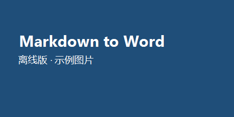

# 一级标题：语法覆盖总览

这是一个段落，包含 **粗体**、*斜体*、***粗斜体***、~~删除线~~、==高亮==、++下划线++、
`行内代码`、\(H_2O\) 下标、x^2^ 上标，以及自动链接 https://markdowntoword.io/zh 。

范围号原样保留：0.85~15 MHz、104~106。

行尾两个空格触发硬换行：  
这是硬换行的第二行。

## 二级标题：列表

无序列表：

- 第一项
- 第二项
  - 嵌套项 A
  - 嵌套项 B
    - 更深一层
- 第三项

有序列表：

1. 安装
2. 配置
3. 运行

从 5 开始的有序列表：

5. 第五步
6. 第六步

任务列表：

- [x] 已完成的任务
- [ ] 待办的任务

### 三级标题：引用与提示

> 这是一段引用文本。
>
> > 这是嵌套引用。

> [!NOTE]
> GitHub 风格的提示块。

> [!WARNING]
> 危险操作的提醒。

#### 四级标题：表格

| 名称 | 年龄 | 城市 | 职业 |
| :--- | :--: | ---: | --- |
| Alice | 28 | London | Software Engineer |
| 张三 | 35 | 上海 | 产品经理 |
| Bob | 41 | New York | Designer |

##### 五级标题：代码

```csharp
// C# 示例：关键字、字符串与注释的高亮
public sealed class Converter
{
    private const string Name = "MarkdownToWord";

    public static int Main(string[] args)
    {
        var count = args.Length > 0 ? 42 : 0;
        return count;
    }
}
```

```python
# Python 示例
def greet(name: str) -> str:
    return f"Hello, {name}!"
```

```json
{ "name": "markdown", "version": 1.4, "enabled": true, "tags": null }
```

```bash
echo "hello" | tr 'a-z' 'A-Z'
```

###### 六级标题：数学公式

行内公式：当 \(a \ne 0\) 时，方程 \(ax^2 + bx + c = 0\) 的解为
\(x = \dfrac{-b \pm \sqrt{b^2 - 4ac}}{2a}\)。

独立公式：

$$
\sum_{i=1}^{n} i = \frac{n(n+1)}{2}, \qquad
\int_{0}^{\infty} e^{-x^2}\,\mathrm{d}x = \frac{\sqrt{\pi}}{2}
$$

矩阵与分段函数：

$$
A = \begin{pmatrix} a_{11} & a_{12} \\ a_{21} & a_{22} \end{pmatrix},
\quad
f(x) = \begin{cases} x^2, & x \ge 0 \\ -x, & x < 0 \end{cases}
$$

带上下限的运算符：

$$
\lim_{n \to \infty} \left(1 + \frac{1}{n}\right)^n = e,
\qquad \prod_{k=1}^{n} k = n!
$$

## 链接、图片与分隔线

外部链接：[Markdown to Word](https://markdowntoword.io/zh "在线转换器")，
邮箱自动链接：someone@example.com 。



---

## 脚注与定义列表

这里引用一个脚注[^note]，再引用第二个脚注[^math]。

[^note]: 脚注内容：说明该结论的来源。
[^math]: 脚注里也可以写公式 \(E = mc^2\)。

术语表：

Markdown
: 一种轻量级标记语言。

Docx
: Word 2007 之后使用的开放文档格式。

## HTML 与其它

<div align="center">
HTML 块内的文本会被提取并保留。
</div>

内联 HTML：<b>加粗</b> 与 <i>斜体</i> 与换行<br>之后的内容。

缩写：HTML 是网页的骨架。

*[HTML]: Hyper Text Markup Language

**结束。**
